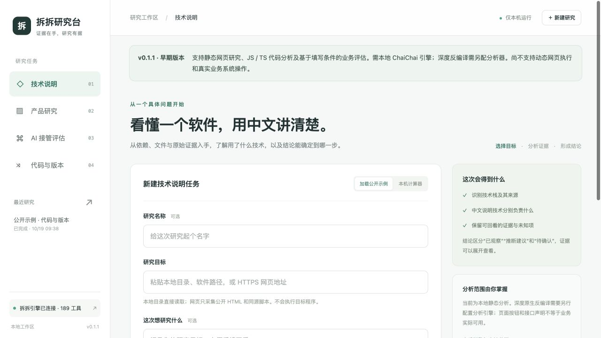

# 拆拆研究台

基于 [ChaiChai](https://github.com/hubooooooo/chaichai) 的本地中文研究工作台。把技术线索、产品入口、业务分工和代码变化整理为可追溯的研究记录。

个人独立开源项目，面向产品研究与代码理解。当前为 v0.1.3 早期版本。

本项目包含中文工作台，配套的[拆拆引擎维护分支](https://github.com/Yiheng-guo/chaichai)包含原引擎代码修复：[文件变化校验、受限流读取及原生关系图边界](https://github.com/Yiheng-guo/chaichai/blob/codex/core-integrity-fixes/docs/fork-core-fixes.zh-CN.md)。

> 当前支持：静态网页研究、JavaScript / TypeScript 代码与版本分析、基于填写条件的 AI 分工评估。需本地安装并构建 ChaiChai；深度反编译另需配置分析器。当前不执行动态网页，不操作真实业务系统，也不调用大模型。



完整案例：[服务工作台两个版本改了什么](docs/version-comparison.md)。包含复现步骤、版本变化、源码证据与结论边界。

## 四类任务

| 任务        | 当前能力                                                                                                    | 结论边界                                                                           |
| ----------- | ----------------------------------------------------------------------------------------------------------- | ---------------------------------------------------------------------------------- |
| 技术说明    | 读取依赖清单、导入声明、文件类型；检查 macOS 应用的框架与运行时依赖                                         | 区分声明依赖与运行证据；文件扩展名仅为线索                                         |
| 产品研究    | 提取静态 HTML 栏目、按钮和导航，关联事件与接口调用位置，提出可借鉴点                                        | 不执行页面；动态界面、后台功能和实际效果需要补充验证                               |
| AI 接管评估 | 根据填写的任务风险、规则和接口条件，形成 AI 辅助、自动处理试点和人工确认建议                                | 业务条件来自填写，未独立核验；不操作真实客户系统                                   |
| 代码与版本  | 解析 JavaScript / TypeScript 函数的参数、分支、调用、计算和返回；比较文件与函数；调用拆拆的应用图追踪和比较 | 动态分派、同名函数、静态语义未知项保持可见；其他语言可识别线索，尚无同等级函数解释 |

原生函数入口可调用已配置的 Ghidra、Hopper 或 IDA，由使用者填写函数名或地址。未配置分析器时显示明确限制，不生成替代伪代码。原生二进制的跨版本比较不属于当前图形工作流支持范围。

每个项目保留输入快照、内容 SHA-256、来源行号、原始拆拆 JSON、阶段记录和中文报告。任务支持排队、取消、失败重试、重启后回看。报告可导出为 Markdown、JSON，或通过浏览器打印保存为 PDF。

## 本地运行

需要 Node.js 24.15 或更新版本、已构建的 ChaiChai。浏览器界面和分析进程均运行在本机。

本版推荐引擎为个人维护分支的 `e887f9e` 提交，基于上游 `74ec6d01074c7df4a0e635bb59b8fe50e5a27607` 增加核心修复。其他版本需验证 CLI 契约兼容。

先在同一父目录准备研究台和原引擎（以下命令适用于 macOS / Linux）：

```bash
git clone https://github.com/Yiheng-guo/chaichai-studio.git
cd chaichai-studio
git clone https://github.com/Yiheng-guo/chaichai.git ../chaichai-engine
git -C ../chaichai-engine checkout e887f9e
cd ../chaichai-engine
HUSKY=0 npm ci
npm run build:cached
cd ../chaichai-studio
npm ci
npm run doctor
npm start
```

`npm run doctor` 会检查 Node.js 版本、npm、研究台依赖、引擎入口及引擎能否启动；失败时输出处理步骤，并返回非零退出码。检查本身不会安装依赖或修改系统软件。`npm start` 和 macOS 启动文件也会先做同样的检查。

| 检查提示                      | 处理方法                                                       |
| ----------------------------- | -------------------------------------------------------------- |
| Node.js 版本不足或 npm 不可用 | 安装 Node.js 24.15 或更新版本，重新打开终端                    |
| 缺少研究台依赖                | 在研究台目录执行 `npm ci`                                      |
| 找不到拆拆引擎                | 按上面的步骤准备相邻的 chaichai-engine，或设置 `CHAICHAI_ROOT` |
| 引擎入口存在，但不能启动      | 在原拆拆目录重新安装依赖并执行 `npm run build:cached`          |

环境就绪只表示基础引擎可调用，不保证任意目标都能完整分析，也不代表商业分析器已安装。

浏览器打开 `http://127.0.0.1:5197`。macOS 可双击 `启动研究台.command`。如果已经运行，不必重复启动。

默认优先使用相邻的 `chaichai-engine`，不存在时兼容原来的 `chaichai-main`。已有的 `CHAICHAI_ROOT` 配置始终优先；如指向旧版引擎，不会自动获得维护分支的修复。引擎不在相邻目录时，在启动前设置绝对路径：

```bash
CHAICHAI_ROOT=/absolute/path/to/chaichai npm start
```

可通过 `PORT` 更换端口，通过 `STUDIO_DATA_DIR` 指定研究数据目录。`.env.example` 为配置说明，本版不会自动加载 `.env`。不需要模型密钥，当前中文解释和评估使用可检查的规则与语法分析，没有外部模型调用。

## 使用示例

1. 在任一任务页选择“加载公开示例”，分析仓库中的服务工作台样例。
2. 在“代码与版本”中比较 `examples/service-v1` 和 `examples/service-v2`，查看价格折扣、工单失败处理和新增质检函数。
3. 在“AI 接管评估”中修改业务任务及条件，再查看分工建议。示例不代表任何企业实际业务。
4. 点击证据位置查看快照；下载拆拆原始结果可进一步复查未解析事项。

真实目标支持本地文本目录、单个文本文件、macOS `.app` 的基础元信息，以及 HTTPS 公网页面。网页仅采集初始 HTML 和最多 12 个同源脚本；无浏览器执行、登录和跨域脚本采集。提取后的 Electron 文本目录可分析，ASAR 应先由原项目提取到本地目录。

## AI 助手与命令行入口

先保持研究台服务运行：

```bash
node src/cli.mjs --mode product --target /absolute/path/to/product
node src/cli.mjs --mode code --target /old/version --right /new/version --question calculatePrice
node src/cli.mjs --id <研究编号> --section summary
```

MCP 启动程序为 `node /absolute/path/to/chaichai-studio/src/mcp.mjs`。服务端口默认为 5197，可用环境变量 `PORT` 变更。该入口不会自动修改任何 AI 客户端配置，也不会替换原有 ChaiChai MCP。

工具包括四类任务创建，以及研究查询、项目列表、来源片段读取和取消。结果支持分页，完整证据继续保存在工作区。调用结果中的源代码、网页内容和业务资料属于待分析数据，不能作为新的操作授权。

## 数据与运行边界

- HTTP 服务只监听 `127.0.0.1`；校验 Host、Origin 和本机会话，不提供远程访问或托管模式。
- 目标源代码不执行；命令通过参数数组启动，不拼接 shell。原项目在其既有契约下管理分析器。
- 网页采集只允许 HTTPS 公网地址；校验每次重定向，固定已验证的 DNS 地址，不携带浏览器登录态。
- 本地快照不跟随符号链接，跳过隐藏文件、`node_modules`、版本库和缓存目录。
- 单文件 512 KB、总文本 8 MB、最多 200 个文件、5000 个目录项；超限和解析遗漏显示在“分析范围”。
- 每份拆拆结果上限 64 MB，默认子进程最长 120 秒；超时或取消会终止拥有的进程组，结果不会被标记为完整成功。
- `.data/` 中可能包含被分析的私人资料。默认不上传，导出报告与原始证据前应确认分享范围。
- 关闭服务时运行任务可能中断；重启会标记未完成任务，保留此前记录。当前不自动续跑原生分析进程。

## 开发与验证

```bash
npm run check
npm test
```

测试覆盖实际引擎调用、四类任务、版本差异、风险判断、来源定位、报告导出、本地请求隔离、取消、失败和重启恢复。CI 使用固定上游提交构建引擎。涉及深度分析器的验证仍需要对应软件和实际目标，静态样例不能替代真实反编译验证。

## 开源与来源

研究台为独立扩展，不更改 ChaiChai 核心源文件。扩展采用 MIT，原项目及第三方声明见 [THIRD_PARTY_NOTICES.md](THIRD_PARTY_NOTICES.md)。仓库只收录扩展代码、许可证和可公开示例，不含公司资料、私人研究记录、第三方软件本体或商业分析器。

研究记录保存在本机 `.data/`，不属于公开示例。提交代码前，应单独确认新增文件及导出报告的分享范围。
