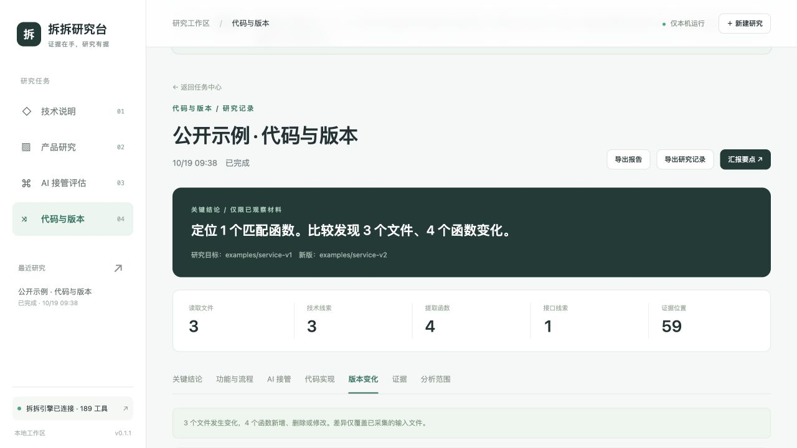

# 服务工作台两个版本改了什么

这是仓库自带的虚构代码样例，不对应任何公司的项目。研究台读取代码，不执行样例，不向真实系统创建工单。

## 复现

1. 按 [安装说明](../README.md#本地运行) 准备引擎，在研究台目录执行 `npm run doctor`，确认通过后执行 `npm start`。
2. 打开 `http://127.0.0.1:5197`，选择“代码与版本”，点击“加载公开示例”。
3. 旧版本为本仓库 `examples/service-v1`，新版本为 `examples/service-v2`，追踪线索为 `calculatePrice`。界面会自动填写本机绝对路径。
4. 点击“开始代码与版本”。完成后查看“代码实现”“版本变化”和“证据”。



也可以在另一个终端进入研究台目录，提交相同任务：

```bash
node src/cli.mjs --mode code --target examples/service-v1 --right examples/service-v2 --question calculatePrice
```

命令返回研究编号。任务异步执行，用返回的编号替换下面的 `研究编号`，查看进度及结果：

```bash
node src/cli.mjs --id 研究编号
node src/cli.mjs --id 研究编号 --section changes
```

## 版本变化和证据

本例有 3 个文件变化：`index.html`、`package.json`、`service.js`。有 4 个具名函数变化：3 个修改、1 个新增。原有匿名点击回调只移动了行号，不应被计为删除和新增。

| 功能     | 旧版行为                      | 新版行为                                                       | 源码证据                                                                                                                 |
| -------- | ----------------------------- | -------------------------------------------------------------- | ------------------------------------------------------------------------------------------------------------------------ |
| 价格计算 | 数量乘单价                    | 增加折扣参数，拒绝负数数量或单价；折后金额最低为 0             | [旧版 calculatePrice](../examples/service-v1/service.js#L1)、[新版 calculatePrice](../examples/service-v2/service.js#L1) |
| 创建工单 | 发出 POST 请求后直接读取 JSON | 增加 JSON 请求头；HTTP 非成功状态时抛出错误                    | [旧版 createTicket](../examples/service-v1/service.js#L6)、[新版 createTicket](../examples/service-v2/service.js#L7)     |
| 人工转接 | 问题含“退款”时转人工          | “投诉”也进入人工确认                                           | [旧版 routeQuestion](../examples/service-v1/service.js#L15)、[新版 routeQuestion](../examples/service-v2/service.js#L18) |
| 回答检查 | 没有该函数                    | 新增 checkAnswer，检查回答是否有值及 sources.length 是否为真值 | [新版 checkAnswer](../examples/service-v2/service.js#L23)                                                                |

例如数量为 2、单价为 100、折扣为 30，旧版计算式为 `2 × 100 = 200`，新版为 `max(0, 2 × 100 - 30) = 170`。这是对代码表达式的解释，不代表研究台实际执行了计算函数。

在“证据”中点击来源位置，可以查看输入快照、行号及内容指纹；在“版本变化”中展开文件差异，查看具体增删行。报告可导出为 Markdown 或 JSON，也可通过浏览器打印保存 PDF。导出文件可能包含本机路径与被分析代码，分享前应确认内容。

## 如何使用这些结论

价格规则和异常路径改变后，需要覆盖折扣超额、负数输入、HTTP 失败和投诉转接等验收场景。研究台帮助定位变化及来源，是否符合业务要求仍需要需求和运行验证。

该样例只有静态页面及调用声明，没有 `/api/tickets` 后端。页面新增“运行检查”按钮，但未绑定调用 `checkAnswer` 的事件。因此不能从新增栏目、按钮和函数推断“质检业务已经可用”。`checkAnswer` 也不验证回答真实性或引用是否支持结论，不能作为完整的回答质检方案。
